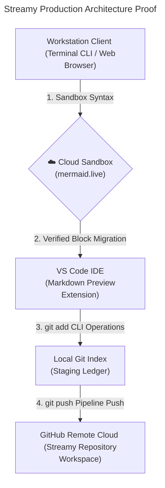
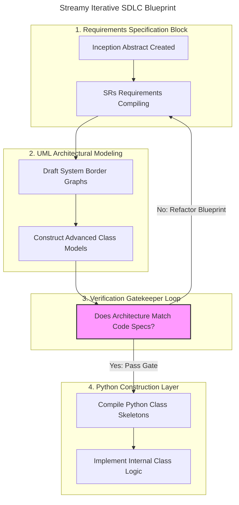

# Streamy Video Streaming Backend Platform

Software Technology Course Laboratory Node

- **Student Identity:** [Guan Jizheng]
- **Neptun System Code:** [RCIHGC]
- **Course Section Reference:** GEIAL314-B2a

## Workspace Environment Architecture

The diagram below maps out how our development environment connects local code authoring to remote version tracking, using a **Diagrams-as-Code** design pipeline.


## Streamy Application Engineering Development Lifecycle

To guarantee systematic software tracking across the implementation lifespan of **Streamy**, our individual developer pipeline follows the structured iterative gate review framework illustrated below.


## Native Mermaid Rendering Test

This section verifies that GitHub natively renders Mermaid code blocks.

```mermaid
flowchart LR
  Client[Web Client] -->|HTTPS| API[API Gateway]
  API --> Service[Listing Service]
  Service --> DB[(Database)]